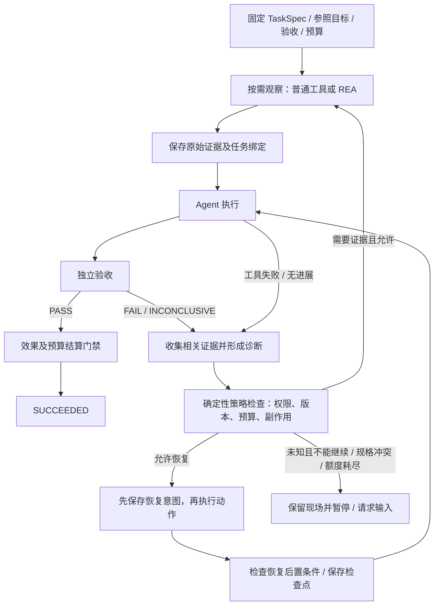

# ForgeAgent × REA：证据驱动自愈 Harness 适配评审

日期：2026-10-14。结论：适合，且可以沿现有 Runtime 增量实现。建议把它定位为“证据驱动的诊断与有限恢复”，由 ForgeAgent 管理恢复决策、权限、预算和最终验收，REA 提供分析证据。

本次仅新增评审文档，没有修改执行代码、安装 REA 或运行目标应用。

## 1. 评审依据与验证边界

- ForgeAgent：`D:/PAI/ForgeAgent`，当前 HEAD `32874e1`。阅读了 Worker、Task/Harness、独立验收、观察封装、进度、远端协议、执行版本绑定、实验与研究、回放、回收和擦除机制及相关测试。
- REA：以用户提供的 `D:/PAI/github/rea` 源码为准，`package.json` 标注 `6.4.0`。该目录没有可用 Git 元数据，不能将版本号当作精确源码提交身份。上线前还须固定源码/构建产物摘要。
- 公网补充：[REA 仓库](https://github.com/morluto/rea)、[MCP 契约](https://github.com/morluto/rea/blob/main/docs/mcp-contracts.md)、[CLI](https://github.com/morluto/rea/blob/main/docs/cli.md)、[安装说明](https://github.com/morluto/rea/blob/main/docs/installation.md)。公网 main 可变化，接口判断优先采用本地源码。
- 尝试运行现有修复与验收测试的选定用例，但本地 PostgreSQL `127.0.0.1:55432` 连接超时，已停止本次 pytest 进程。没有新的测试通过结果。
- 未完成真实 REA/ForgeAgent 联调、桌面动态观察或真实模型修复评测。以下区分已有实现与拟议改动，不以源码存在推断实际修复收益。

## 2. 当前项目结构与方案对应关系

```text
ForgeAgent/
├─ backend/forgeagent/
│  ├─ domain.py / service.py       任务、能力、预算、创建与控制
│  ├─ worker.py / db.py            PostgreSQL 持久调度、动作、租约与 fencing
│  ├─ observation.py / progress.py 原始观察引用、失败类别、无进展检测
│  ├─ verification.py             固定契约、独立验收、测试与配置保护
│  ├─ repository.py / repo_tools.py / workspace.py
│  │                               固定 Git 基线、范围操作、快照与 CAS
│  ├─ sandbox.py / sandbox_manager.py / resources.py
│  │                               容器、受控执行、root 资源账本
│  ├─ context.py / code_index.py   约束优先上下文、来源引用与代码检索
│  ├─ remote.py / remote_contracts.py
│  │                               MCP/A2A、授权、外部效果与对账
│  ├─ semantic.py / reducer.py     执行绑定、归档执行器、事件重建
│  └─ evaluations.py / research.py / pilot.py
│                                  配对实验、成本和效果报告
├─ src/                            React 控制台、时间线、恢复与验收页面
├─ migrations/                     数据库迁移与完整性约束
├─ tests/backend/ / tests/frontend/ 后端机制与前端契约测试
└─ sandbox/ / infra/ / benchmarks/ 运行环境、部署与评测
```

| 原方案步骤 | 已有基础 | 适配缺口 |
|---|---|---|
| Task Spec | Task、Budget、capabilities、固定验收与语义绑定 | 增加参照目标、观察环境和恢复策略的明确绑定 |
| REA Observe | 仓库读取/搜索/符号、容器测试、远端工具 | 尚无 REA 专用执行、会话和证据接入 |
| Evidence Ledger | Action/Attempt、对象摘要、观察 envelope、VerificationResult、事件 | 尚无跨来源的“事实—假设—未知项—支持/反证”索引 |
| Agent Execute | 固定基线、隔离工作区、范围/CAS、预算 | 直接复用；无需替换模型或 Runtime |
| Verifier + REA | 独立只读容器、PASS/FAIL/INCONCLUSIVE、证据版本绑定 | REA 补充诊断证据；行为验收需要另行注册明确契约 |
| Diagnose & Recover | 有限验收修复、基础故障分类、无进展暂停、检查点 | 缺少持久诊断结论、策略选择、恢复前提与效果核验 |

这里“已有证据记录”并不等于“已有证据驱动诊断”。现有 `progress` 主要记录执行进展，不能直接充当语义事实账本。

### 现有修复回路的真实行为

`Worker.complete()` 对固定工作区执行独立验收后：

1. PASS：通过最终可结算门禁后完成。
2. FAIL 且 `failure_class == acceptance`：预算允许时进入 `REPAIRING`，清除 completion，增加 `repair_attempts`，注入 `verification_feedback`。
3. FAIL 且硬约束失败，或修复次数耗尽：FAILED。
4. INCONCLUSIVE：PAUSED。

默认 `max_repair_attempts=2`。已有机制测试覆盖有限修复及其持久计数。本方案最自然的切入点，就是上述第 2、4 个分支，以及工具失败后下一次模型决策之前。

## 3. REA 中值得复用的能力

REA 是 TypeScript/Node 的本地分析工具，提供共用的 CLI/MCP 工作流。其核心用途包括应用结构、二进制和运行时行为分析；它不会天然提供 ForgeAgent 业务所需的根因结论或恢复策略。

本地源码确认：

- `src/domain/evidence.ts`：Evidence 带 `evidence_id`、subject 摘要、provider、analysis_profile、operation、parameters、raw/normalized result、来源位置、evidence_links、limitations。
- `confidence` 是 `observed / derived / inferred` 三种认识类型，不是统计置信概率；`authority` 和 `environment` 另有字段。
- `src/domain/residualUnknown.ts`：未知项有稳定身份、修订链、支持/反证、建议 probe、所需 authority/confidence/environment 和 resolution。
- `src/domain/evidenceCompletionLedger.ts`：逐 claim 记录 pass/fail/unsupported/truncated/unknown。它可用于导入分析结论的完成情况，不能直接替代 ForgeAgent 独立验收。
- `analyze_javascript_application`、`inspect_analysis_view`、`trace_application_feature`、`trace_javascript_semantics` 可以支持 Electron/JavaScript 搜索功能的结构分析及进一步追踪。
- `get_evidence_bundle`、`export_evidence_bundle`、`import_evidence_bundle` 和 unknown 工具可用于保存、转移和恢复分析记录；会话恢复不等于原分析进程或被观察进程恢复。
- `src/contracts/toolEffects.ts` 分别声明启动进程、执行外来代码、写文件、网络、UI、设备、会话变更和可能丢失数据等效果。这比把所有 REA 操作统称“只读分析”准确。

建议保留 REA 原始记录，并在 ForgeAgent 外层增加任务绑定和治理索引。避免重新实现 REA 的 Evidence ID、canonicalization 和 unknown 修订规则。若需要验证其原生身份，使用固定版本的 REA 解析/验证边界；ForgeAgent 自己的对象摘要用于保存完整字节，两套摘要各司其职。

## 4. 三种接入方式

| 方式 | 工作量/风险 | 优点 | 代价与适用条件 |
|---|---|---|---|
| A：现有证据先行，增加诊断与恢复；REA 先做受控 CLI 静态任务 | 中 / 较低 | 最少改动，可先测恢复收益；不依赖桌面会话 | 原生冷启动与跨调用会话暂不覆盖；是推荐首期 |
| B：Worker 直接管理每个 Run 的 stdio MCP 会话 | 中到大 / 中高 | 接口直接，可保留热分析会话 | Worker 承担 Node/provider 进程、OS 权限、归属和跨节点接管；适合受控单机原型 |
| C：专用 Observation Runner 管理 REA，Runtime 用受控接口调度 | 大 / 中高 | 观察环境和业务执行分开，可支持 Windows/macOS/Linux | 增加作业、会话和部署管理；是后续动态分析的目标形态 |

推荐 A → 按实际需要引入 C。首期 Runner 可以只是同机受监督进程，不必立刻拆网络服务。不要先做通用插件平台，也不要把整个 REA 工具目录一次性暴露给模型。

### 为什么不能直接登记现有远端连接

REA `server.json` 声明 stdio，`src/main.ts` 使用 `serveStdio`；ForgeAgent 当前 MCP 路径使用 HTTPS Streamable HTTP/JSON RPC。二者传输不直接匹配。

此外，ForgeAgent 的 MCP 2025-11-25 路径会为每次 dispatch 创建连接和 ClientSession，调用后关闭。即使增加 HTTP 包装，也必须处理 REA 会话绑定，否则 `open_binary`、分析和后续查询可能不在同一个会话。

后续如服务化，使用受信任控制平面的独立配置与认证方式，参考 sandbox manager 的边界。不要为了访问 localhost/私网 Runner 而放宽现有通用远端连接的 SSRF 规则。

## 5. 建议的执行闭环



这是一条条件分支，不要求所有任务机械地先跑 REA。普通代码缺陷优先复用测试和日志；只有参照逻辑不明、跨边界行为缺证据，或普通诊断不能区分候选原因时，再调用 REA。

### 状态适配

保留既有 Run.status：ACTIVE/WAITING/PAUSED 等。新增阶段可用 `DIAGNOSING`、`RECOVERING`，继续复用 `VERIFYING` 和 `REPAIRING`；不为每个故障类别新增顶层任务状态。

所有诊断/恢复都必须是可持久恢复的阶段，不能只在 `except` 中做一串进程内重试。下一次 `Worker.advance()` 应识别已保存的 recovery 进度，继续原操作或验证其结果。

UNKNOWN 外部效果、未知账单、取消、权限撤销、语义漂移和硬额度门禁优先于任何自愈分支。已有 `require_finalizable()` 与 fencing 不能被诊断模型绕过。

### 最小数据模型

首期采用三个职责清楚的记录，正文仍放现有对象存储：

| 记录 | 最小内容 |
|---|---|
| EvidenceRecord | source、原始对象 ref、来源原生 ID、采集时间、subject/target 摘要、workspace/环境/验收/输入版本、coverage/limitations、可见性 |
| Diagnosis | 触发 failure、候选原因、支持/反证引用、结论状态、未知项、下一项可区分候选原因的 probe、诊断器/策略版本 |
| RecoveryAttempt | 诊断引用、策略、前置摘要、动作/operation ID、预算预留、执行状态、后置检查和再次验收引用 |

事实、假设、未知项可先作为 Diagnosis 中有类型的条目；暂不增加通用知识图谱。现有 `Run.state` 只放当前记录 ID、阶段、计数和小型摘要，避免把整个 REA 图塞入状态、每次事件和检查点。

至少建立以下绑定：

`tenant + run + task/input revision + workspace digest + artifact version + acceptance digest + environment identity + observer/policy version`

参照应用另绑定 `reference_target_id + artifact digest`，动态观察另绑定环境、场景与时间。原应用证据与 ForgeAgent 当前产物不能共用一个含糊的“目标摘要”。

证据是否过期按依赖判断：工作区修改使实现相关结论失效，但没有改变参照应用时，不应让它的全部证据一并失效。浏览器/进程的实时状态则不能仅靠文件摘要证明仍然有效。

## 6. 对故障分类方案的必要修改

原有六类适合作为业务诊断候选，不宜取代 Runtime 已有的授权、资源、冲突、对账等治理类别。建议区分三个维度：

1. **观察到的结果**：PASS/FAIL/INCONCLUSIVE、超时、退出码、错误码、未决效果。
2. **原因假设**：目标理解、实现、环境、工具、规格或未知；允许多个候选。
3. **诊断状态**：待验证、有证据支持、有反证、未知。证据不足是一种判断状态，不必强行成为独占根因。

`FAIL` 只能证明固定验收没有通过，不能直接证明实现有错。`INCONCLUSIVE` 也不能证明环境错误。当前 `verification.py` 把 INCONCLUSIVE 统一归为 environment，新增系统应细分原因而保持验收 verdict 的含义。

| 类别/状态 | 允许的恢复 | 必须保留的边界 |
|---|---|---|
| 目标理解错误候选 | 定向追踪原应用的函数、IPC、路由或运行场景，更新假设 | 静态关系不能单独证明离线运行行为 |
| 实现错误候选 | 在允许路径修复实现，先跑公开测试，再独立验收 | 不削弱既有测试、保护配置或隐藏验收 |
| 环境错误候选 | 在同一固定镜像/依赖下重建临时环境、初始化受审测试夹具 | 数据写入限定于该任务的测试环境；新依赖/镜像需新绑定，不能静默更换 |
| 工具错误候选 | 恢复属于该任务的会话、读取已保存结果；满足重发条件时重试 | 超时不等于操作没有发生；先确认进程归属、旧作业状态及效果 |
| 规格冲突候选 | 保存冲突证据、请求澄清；需要修改验收时创建明确的新契约版本与任务绑定 | 补充 input 不等于自动改写已固定验收 |
| 诊断未知/证据不足 | 做一项授权、预算允许且能区分假设的 probe；否则暂停 | 不要求模型每次编出根因；不允许靠不断换 prompt 重置预算 |
| 授权/资源/对账/语义冲突 | 沿用现有暂停、等待、审批、对账或显式迁移/fork | 不纳入任意“自愈绕过” |

采用“规则先行，模型补充”的诊断顺序：明确错误码和证据绑定先排除确定问题；模型只提交带证据引用的候选原因与建议动作；确定性策略层校验其合法性。没有证据时输出 unknown，而不是给一个没有校准依据的高置信百分比。

一次恢复成功需要两层检查：先验证所选策略的后置条件，例如“测试数据库夹具已建立”“旧会话已关闭”；最终仍由独立验收判定任务是否完成。临时故障消失不能单独证明原诊断正确。

## 7. REA 适配中的工程问题

### 7.1 三个环境边界

明确区分：参照应用观察环境、代码实现工作区、独立验收环境。当前 ForgeAgent 主要运行离线 Linux 容器；Windows/macOS 桌面应用、GUI 和原生 provider 不能视为这个沙箱已经具备的能力。

首期优先 JavaScript/Electron 静态分析，避免一开始同时支持 Hopper/Ghidra/IDA、浏览器驱动和进程注入。后续按 capability readiness 选择实际支持的 OS/provider，不以“REA 支持某领域”推断每个平台支持相同行为。

### 7.2 观察权限并不都是只读

调用方使用 `target_id` 和审核过的操作，Runner 将它解析成允许范围内的本地路径。不要让模型提供任意宿主路径、shell 命令、provider 安装参数或未审核 URL。

按 REA 的完整 effect vector 审核操作。静态文件观察、启动被分析程序、驱动浏览器 UI、写测试数据、注入和设备变更需要不同授权。会话追加 Evidence 不应自动被视为业务写入；运行外来代码也不能因为工具名含 inspect/capture 就自动获得只读授权。

首期不暴露动态高影响操作。后续在 ForgeAgent 策略层建立明确能力/审批映射，而不是只信工具自报注解。目标程序退出状态、浏览器端点和进程归属不明时，保留未知状态，不能按 PID 杀任意进程。

### 7.3 会话与故障恢复

REA session 保存目标绑定、分析记录与未知项。Runner 应把 session 绑定到租户、Run、目标、provider/profile 和执行 epoch，使用专属临时目录并管理进程所有权。

Worker 接管后先核对旧作业及会话，不能直接创建第二个相同动态观察。导出的 bundle 恢复的是证据，不能证明被观察进程仍然存活或行为仍然相同。已有结果应先落入 ForgeAgent 对象存储，不能仅依赖 REA 进程内 retention。

CLI 每次调用是独立进程，适合首期一次性静态任务；跨调用需要显式传递已保存 Evidence。后续原生深度分析才有充分理由增加长会话。

### 7.4 时限、结果体积与成本

ForgeAgent 远端代码有 30 秒 HTTP 请求配置，部分 JSON RPC 路径有 1 MiB 响应上限；REA 原生分析有冷启动，完整 Evidence 也可能很大，不能照搬这些限制后把超时误认为目标缺陷。

建议 Runner 采用 start/status/result/cancel 作业语义：启动请求短时返回，长任务持久排队，结果按摘要保存。区分排队、provider 冷启动、分析执行、传输和任务总时限；时限仍受 root 剩余预算约束。

使用 REA summary/view/paging 保留覆盖和来源，模型只看到当前问题相关证据及引用。读取 summary 不代表完整数据已持久保存。大对象超出现有上传/存储上限时显式停止或使用受控产物通道，不能无界提高全局限制。

现有 `resources.py` 对容器执行有预算控制；新增 Node/provider 进程不会自动进入同一 CPU 账本。Runner 必须计入模型/工具调用、墙钟、CPU/内存和证据存储；首期至少限制并发、运行时间、输出和存储，并明确尚未计量的成本。

### 7.5 证据不等于授权或真相

保留原始来源、推导、反证、覆盖和限制。内容哈希能检查完整性，不能证明语义正确。REA 输出及目标中的字符串、网页、反编译文本均是非可信输入。

隐藏验收和公开诊断必须分开：REA/模型只接收允许公开的失败摘要、公开测试与任务约束。不能把隐藏测试、内部断言或泄露它们的运行日志发送给观察服务。诊断经 Runtime 保存后也不能升级成可以提权的 system 指令。

## 8. 用“离线搜索”任务检验设计

任务开始应固定：参照应用版本/摘要、允许观察的功能和数据、目标项目路径、恢复额度，以及可执行验收。仅在 `criteria` 写“支持离线”不构成自动证明。

可注册的行为至少包括：已建立索引后的断网搜索、冷启动离线、索引持久化、空查询/无结果，以及与需求有关的中文或文件变更场景。测试输入和期望应由受信任验收流程确定，不从待实现代码中反向生成宽松标准。

假设测试失败：

- 若测试进程无法启动，先检查固定环境与命令，不立即修改查询逻辑。
- 若测试已执行但数据库缺测试夹具，检查数据库身份和初始化证据；只修复任务的临时夹具，再跑相同验收。
- 若实现成功发送网络请求但离线查询无结果，公开测试和运行证据支持检查网络依赖/本地回退逻辑，仍不必马上启动二进制分析。
- 若不清楚参照应用是本地索引、远端搜索还是混合模式，再对已固定的参照应用调用 REA 定向观察。发现 SQLite/FTS 字符串只能形成静态候选，离线能力需要实际场景或明确验收支持。
- 若 REA 只能给静态关联，记录“离线运行行为未知”，选择获准的动态场景或暂停，不将其包装成已确认事实。
- 若真实需求与验收冲突，提交规格冲突证据；不自动修改测试让任务通过。

每次恢复记录改变了什么条件、依据哪条证据，以及同一验收如何再次执行。这样才能区分修复实现、修复环境和偶然重试成功。

## 9. 分阶段落地与修改位置

### 第一阶段：现有证据驱动的有限恢复

目标是证明恢复策略的有效性，不要求先接通桌面分析。

- `domain.py` / `state_types.py`：增加有界 recovery 配置和结构化 Diagnosis/Recovery 类型。现有 `max_repair_attempts` 继续约束代码修复，新增诊断/probe/工具恢复额度不能成为另一套无限重试。
- `db.py` + 下一版 migration：持久 Evidence/Diagnosis/RecoveryAttempt，沿用租户/run 外键、RLS、不可变正文与生命周期约束。历史任务采用明确默认值，新功能先显式启用。
- 新建小型 `diagnosis.py`、`recovery.py`：前者收集/关联证据和确定错误码，后者选择已审核策略、检查前提及停止规则。不要重写调度器。
- `worker.py`：在工具失败和独立验收失败后进入可持久诊断阶段；先提交恢复意图，再通过既有 Action/Attempt 派发；重启后继续同一 recovery operation。
- `verification.py`：保留三态 verdict，增加具体 inconclusive reason 和结构化失败事实。首期不自动恢复硬约束失败。
- `progress.py` / `context.py`：加入诊断相关的新证据判定和小型摘要；重复证据、换写入参数、换 prompt 或重启 session 不能无限重置无进展判断。
- `semantic.py`：将新执行模块、策略/观察器版本纳入执行绑定。旧任务通过明确迁移/fork 使用新逻辑，归档执行器继续维持原语义。

无需第一阶段就增加自由生成的 recovery 命令。先做确定性策略；如第二阶段需要模型提交恢复建议，再增加有类型的提案，并同时修改 Decision/schema/native tool 生成与验证路径。

### 第二阶段：REA 静态分析接入

- 固定 REA 版本和构建摘要，增加受监督 CLI/stdio 适配，避免运行时使用 `npx @latest` 下载执行。
- 小范围暴露 JavaScript/Electron 分析、相关视图/追踪、证据导出；用固定样本建立真实接口集成测试。
- 采用 REA 原生 Evidence/unknown 语义，增加 ForgeAgent 外层任务绑定。
- 创建 `reference_target` 注册与允许路径映射；参照应用不进入可写实现工作区。
- 复用现有恢复页面与任务时间线，显示“依据、候选原因、未知项、采取的动作、再次验收”，无需新建整套控制台。

### 第三阶段：受控动态观察

有真实场景需要后，再增加 OS 专用 Runner、长作业、provider 生命周期和动态效果授权。逐个验收浏览器、进程、原生 provider，不把全部能力作为首期依赖。

### 容易漏掉的配套改动

新记录要覆盖 API 权限/正文过滤、分页、OpenAPI 与生成的前端类型、事件重建、备份、引用图、数据擦除和旧版迁移。

现有维护代码可扫描 ORM JSON 引用，联合备份也有复用基础；但 `knowledge_erasure.py` 的任务相关删除列表是显式枚举，必须加入新记录，不能假定新增表会自动被擦除。

另外已有分类口径需要先统一：`progress.failed()` 将类别保存为 `last_failure.class`，`research.snapshot()` 读取的是 `last_failure.category`；`VERIFICATION_FAIL/INCONCLUSIVE` 在通用错误码映射里也没有对应的细分类。若不修正，新增恢复系统的实验指标会丢失或误归类故障。

## 10. 验收、可观测性和待定事项

### 最低必要测试

1. 实现错误走代码修复；环境故障不改业务文件；规格冲突和 unknown 走正确停止/补证据路径。
2. INCONCLUSIVE 不被当成实现错误；诊断不能把 INCONCLUSIVE 改成 PASS。
3. 支持/反证和日志截断保留；缺失关系/空结果不被当成完整证明。
4. 证据版本失配、输入变更、权限撤销、取消和 lease 接管使过时提案无法执行。
5. 恢复意图提交后、派发后、结果保存后分别崩溃，不重复未知外部效果，不重复收取同一已结算 operation。
6. 重复失败签名且无新诊断证据时停止；诊断/probe/修复均受 root 预算约束。
7. 隐藏验收不泄露；Runner 路径逃逸、跨租户 Evidence、目标内容提示注入被拒绝。
8. 使用真实 REA 公开 CLI/stdio 工作流验证导出、导入、关闭/重建和不支持的 provider；模拟输出只证明本地适配逻辑。

测试应覆盖这些跨边界性质，避免给每个简单字段堆镜像实现的单元测试。

### 实验设计

复用现有 evaluations/research/pilot，先比较：当前有限反馈修复 vs 证据驱动恢复；随后在相同恢复策略下比较不使用 REA vs 按需 REA。固定模型、仓库基线、验收、总预算与重复次数，按任务/问题族配对分析。

记录最终独立验收率、正确恢复策略率、误分类/unknown、恢复耗时、额外模型/工具/CPU/存储成本、人工介入和负迁移。保留失败、超时和费用未结算样本，不能只统计恢复成功案例。

现有 research 的 recovery 时延主要描述租约接管，应与这里的诊断恢复分别命名和统计。仅增加重试次数导致成功率上升，不能证明诊断系统有效。

运行事件至少覆盖诊断开始/保存、补证据、恢复选择/拒绝、派发、后置验证和停止原因。控制台要有“仍未知”“等待授权”“额度耗尽”和“证据已过期”的清晰状态。诊断模型输出保存简短可核查理由，不要求保存私有思维过程。

### 当前仍需在实施前固定的事实

- 首个参照应用是 Electron、Web、.NET 还是原生程序；是否需要启动目标和 GUI。
- 首个部署是单机还是共享多租户，Runner 与 Worker 位于哪些 OS。
- 首期可批准的操作集合、数据范围，以及最长冷启动/动态观察成本。
- 当前缺少真实模型、容器及 REA 联调效果证据；代码机制可行不等于收益已被证明。

这些不影响本次适配结论：先增强 ForgeAgent 已有诊断恢复回路，再把 REA 作为按需证据来源，是最符合当前项目结构的路径。
